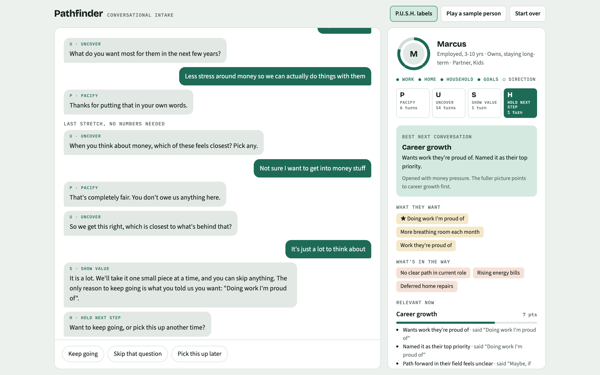
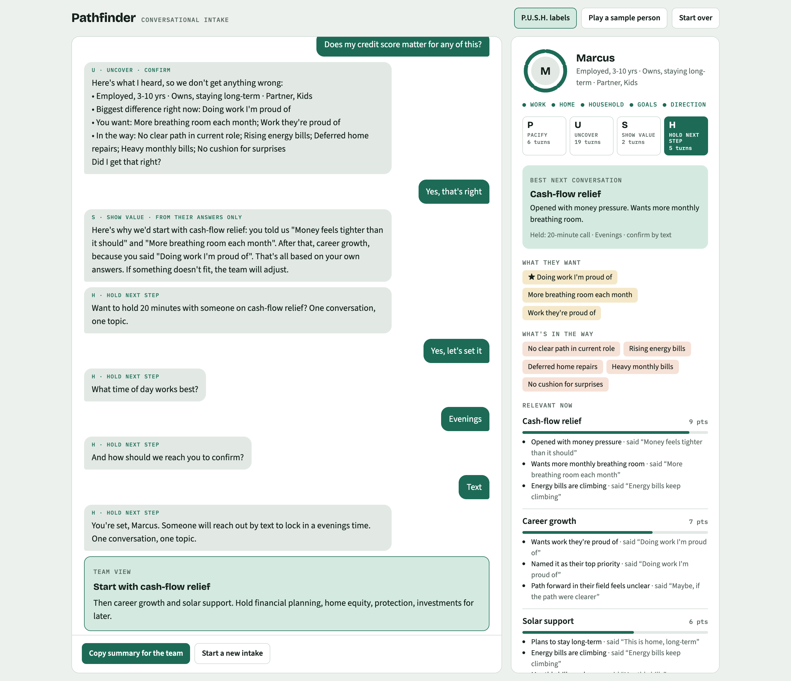
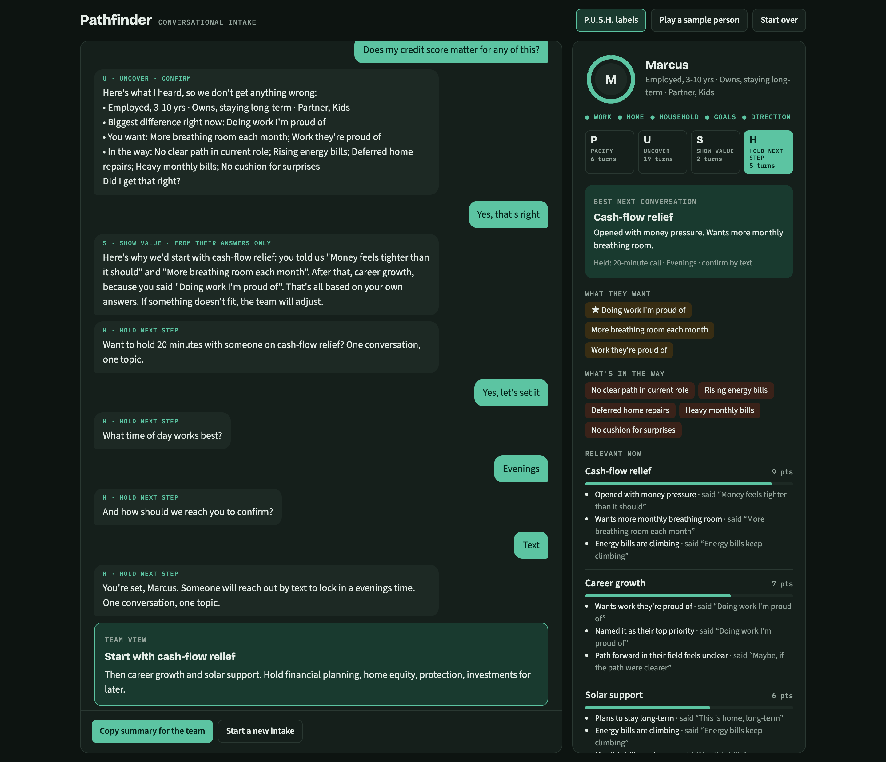
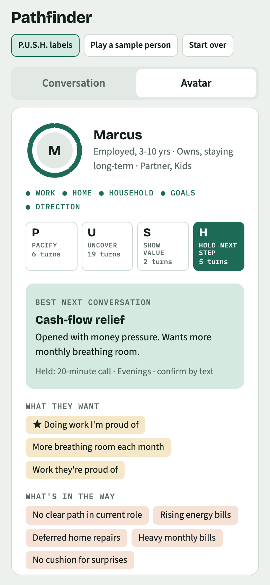
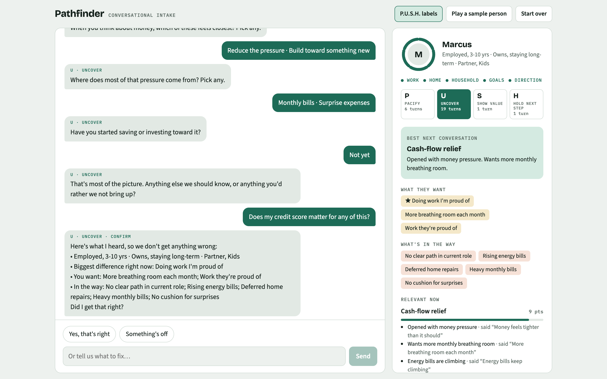

# Pathfinder Intake

**Find the best next conversation, not the first product mentioned.**

Pathfinder is a conversational intake. It learns what someone wants before anyone pitches them anything. It handles hesitation with the P.U.S.H. objection framework, and every recommendation it makes links back to something the person actually said.



No build step, no framework, no runtime dependencies. Clone it, run it, and change it by editing plain config files.

```bash
git clone https://github.com/rayadamas/pathfinder-intake.git
cd pathfinder-intake
npm start
```

Open `http://localhost:5173`, or `http://localhost:5173/?sample` to watch a scripted walkthrough.

---

## What it does

**For the person filling it out**, it feels like a conversation, not a form:

- It opens wide: *"Tell us a little about where you are today and what you want to change."*
- The questions are broad and low-pressure. Every one offers tappable answers plus room to answer in their own words. There are no dropdowns and no yes/no forks.
- Each answer decides the next question. "Self-employed" leads to questions about the business. "We own" leads to how long they plan to stay.
- Money comes last, and it never asks for numbers.

**For the team**, it builds an evolving avatar, not a label:

- **Best next conversation**, with the reasons behind it, plus a note when the fuller picture disagrees with what they opened with
- **What they want** and **what's in the way**
- **Relevant now** versus **save for a later follow-up**, with timing notes: for example, investments wait until monthly pressure eases
- **Hesitations**, each with the missing ingredient (Trust, Urgency, Need, Emotion) and how it resolved
- **Their questions**, marked as answered from approved facts or passed to the team
- **A copyable summary** for handoff

| Team view | Dark mode | Mobile |
|---|---|---|
|  |  |  |

## The method

### P.U.S.H. on every turn

Every message the intake sends is tagged with a stage. Turn the tags on with **P.U.S.H. labels** in the header.

| | Stage | What the intake does |
|---|---|---|
| **P** | Pacify | Acknowledges what the person said without getting defensive |
| **U** | Uncover | Asks open questions to find what's really going on |
| **S** | Show value | Connects back to the person's own stated problem or goal |
| **H** | Hold next step | Ends with a booked next step so the conversation doesn't just stop |

When someone hesitates ("not sure I want to get into money stuff"), the intake pauses the normal questions and runs all four steps:

1. It acknowledges the hesitation.
2. It asks what's missing: Trust, Urgency, Need, or Emotion.
3. It answers that concern using something the person already said.
4. It offers to keep going, skip the question, or pick up later.

The same loop runs if they turn down the call at the end.

### Guards against made-up answers

The intake never generates facts. It only:

1. **Repeats approved answers.** Questions the person asks get an answer only if they match one of the entries in [`src/config/faq.js`](src/config/faq.js). Anything else gets *"I don't want to guess at it"* and goes on a list for the team.
2. **Quotes the person back.** Every point toward a service is stored with the exact answer or words that earned it. The "Show value" message is built only from those quotes, and a test checks that every quoted line was actually said.
3. **Checks before it suggests.** Before it suggests anything, it reads back what it heard and asks the person to confirm or correct it. Corrections update the profile.
4. **Explains itself.** "Why do you ask?" is under every question. It gives a one-line reason and then offers a skip.

The team panel shows four **grounding checks** so a reviewer can see at a glance whether each guard held.



## Before real use: rewrite the approved answers

> [!IMPORTANT]
> [`src/config/faq.js`](src/config/faq.js) ships with **five placeholder answers**: cost, "is this a pitch", privacy, length, and what you do. They are there so the demo works and so the approach is clear. They are not true for your organization. Rewrite each one, and have someone with authority sign off, before this goes in front of real people.

Those five entries are the only facts the intake will ever state. Keeping that list short and approved is what stops it from making things up.

## Customizing

Everything specific to your business lives in [`src/config/`](src/config/). The engine doesn't need to change.

| File | What it controls |
|---|---|
| [`questions.js`](src/config/questions.js) | Every question, its answer options, how answers branch, and what each answer adds to the profile |
| [`services.js`](src/config/services.js) | The services a conversation can point toward |
| [`rules.js`](src/config/rules.js) | Score thresholds, plus rules that rule a service out or push it to later |
| [`faq.js`](src/config/faq.js) | The approved answers (see above) |
| [`push.js`](src/config/push.js) | P.U.S.H. wording: objection patterns, the "what's missing" options, Show value lines |
| [`keywords.js`](src/config/keywords.js) | Signals read from free text |
| [`topics.js`](src/config/topics.js) | Topic order and the "Why do you ask?" answers |
| [`copy.js`](src/config/copy.js) | The playback check, next-step offer, and goodbye |
| [`sample.js`](src/config/sample.js) | The scripted sample person used by the demo, tests, and screenshots |

See [docs/customizing.md](docs/customizing.md) for worked examples.

## Project layout

```
index.html            entry point
src/
  config/             your content and rules (edit these)
  core/               engine, scoring, classification, narrative (no DOM)
    engine.js         the conversation state machine
    classify.js       answer vs. question vs. objection
    plan.js           scores to "relevant now" / "later"
    narrative.js      every sentence built about a person
  ui/                 chat, avatar panel, DOM helpers
  main.js             wires the engine to the page
tests/                node:test suites, run headless against the engine
scripts/
  serve.mjs           zero-dependency static server
  screenshots.mjs     regenerates docs/screenshots and docs/social
docs/                 screenshots, social cards, guides
```

The engine in `src/core/` never touches the page. The browser, the test suite, and the screenshot script all run the same code.

## Scripts

| Command | What it does |
|---|---|
| `npm start` | Serve the app at `http://localhost:5173` (set `PORT` to change it) |
| `npm test` | Run the test suite (Node 18+, no install needed) |
| `npm run screenshots` | Regenerate every image in `docs/` (needs `npm install` and, the first time, `npx playwright install chromium`) |

URL options for demos: `?sample` plays the sample person, `&speed=instant` skips the typing delay, `&stopAt=resume` pauses on a given question, `&view=avatar` opens the avatar tab on phones, and `&labels=off` hides the P.U.S.H. tags.

## Deploying

It's a static site. Any static host works, including GitHub Pages: push the repo, then turn on Pages for the `main` branch, root folder. It must be served over http(s), because ES modules won't load from `file://`.

Nothing is stored or sent anywhere. To collect real intakes, connect `onDone` in [`src/main.js`](src/main.js) to your CRM or a form endpoint. `summaryText(state)` in [`src/core/narrative.js`](src/core/narrative.js) already produces a plain-text handoff.

## Shareable images

[`docs/social/`](docs/social/) holds images rendered from the live app:

- `linkedin-landscape.png`: 1200×627, for link previews and feature images
- `linkedin-portrait.png`: 1080×1350, for feed posts
- `portfolio-wide.png`: 1600×1000, for portfolio sites

All are rendered at 2x. Edit [`docs/social/card.html`](docs/social/card.html) and run `npm run screenshots` to rebuild them.

## Credits

The P.U.S.H. objection framework (Pacify, Uncover, Show value, Hold next step) comes from the *Sales Execution Starter Kit*.

Built by Diamond Ray Louden. Released under the [MIT License](LICENSE).
